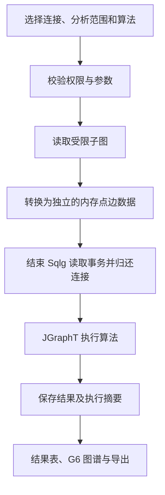

# 图计算方案

## 1. 目标与推荐方案

在平台中新增独立的「图算法」菜单，支持对所选图库或子图执行路径分析、节点重要性分析和连通性分析，并通过结果表与图谱展示结果。

推荐采用 **Sqlg 读取数据、Java 后端 JGraphT 执行算法、React + G6 展示结果** 的架构，复用现有连接管理、权限、审计日志和任务中心。

第一期已实现：独立图算法菜单、四类算法、受限子图投影、异步任务、取消、结果文件、中英文界面、G6 展示及查看 / 执行 / 导出权限。JGraphT 依赖版本为 1.5.3。

### 当前实现边界

- 分析范围为单个 Schema，支持多点类型、多边类型和文本属性精确过滤。未选择类型表示全部类型；属性过滤作用于点，边仅保留两端均在所选点集合中的边，包含孤立点。邻域范围作为后续扩展。
- 默认上限为 5,000 个点、20,000 条边、30 秒；可调整至最多 20,000 个点、100,000 条边、120 秒。超限整体失败，不采样、不截断计算。这些限制约束内存规模，生产环境仍需按真实数据压测调优。
- 权重必须存在且为 0 至 1e12 的有限数值。最短路径使用 Dijkstra；不带权模式按单位成本计算。PageRank 在 JGraphT 图模型上执行可取消迭代，处理孤立点、无出边节点和出边权重全为零的节点，并输出迭代次数、收敛状态和最大分数变化。
- 任务类型为 `GRAPH_ALGORITHM`，归入任务中心的「统计」分类。结果保存为任务 JSON 文件，可通过任务 ID 重新打开。查看、执行及导出权限分别为 `graph_algorithm:view`、`graph_algorithm:execute`、`graph_algorithm:export`，普通角色需授权。
- 图谱最多显示 500 个点和 2,000 条边；结果表显示配置的前 N 行，完整计算结果保存在 JSON 中。平行边分别计数，自环计入入度与出度，总度计 2。
- 查询结束后立即回滚读取事务，再进行内存计算。SQL 语句受 PostgreSQL 超时约束，读取与算法循环检查取消和整体截止时间。读取取消在正在执行的 SQL 返回或达到语句超时后生效。
- 结果包含数据读取起止时间，当前不保证并发修改下的一致快照，不回写图库属性。

## 2. 现有架构与技术限制

- 图存储：Sqlg 3.1.6 + PostgreSQL。
- 后端：Java 21、Spring Boot。
- 前端：React、AntV G6。
- 已有能力：连接管理、Topology 浏览、点边数据管理、关系展开、Gremlin 控制台、任务中心。

Sqlg 3.1.6 官方文档将 `Computer` 列为未实现特性，即不支持 TinkerPop GraphComputer。因此不能直接在当前 Sqlg 图上使用依赖 GraphComputer 的 `pageRank()`、`connectedComponent()` 等算法步骤，需要另建算法执行层。

参考：[Sqlg 3.1.6 官方文档](https://sqlg.org/docs/3.1.6/)。

## 3. 方案比较

| 方案 | 适用场景 | 优势 | 限制与定位 |
| --- | --- | --- | --- |
| 后端 JGraphT | 路径、连通性、中心性分析 | 可直接集成 Java 后端，便于权限控制、任务执行和结果保存 | 内存消耗取决于子图规模及算法；作为首选方案 |
| 前端 `@antv/algorithm` | 已加载到画布的小规模子图分析 | 可与 G6 配合，交互反馈快 | 占用浏览器资源，结果仅代表已加载子图；作为辅助能力 |
| Gremlin 遍历 | 限定层数的邻域、可达性和关系路径查询 | 复用现有图库查询能力 | 需控制深度、分支和结果规模；适合局部查询 |
| 独立算法服务 | 大规模全图计算、复杂社区发现 | 可以独立扩容，并按需选择专用计算引擎 | 增加部署、数据传输和运维成本；作为后续扩展 |

JGraphT 提供 BFS、Dijkstra、K 最短路径及 PageRank、介数中心性等算法。具体依赖版本在实施时根据 Java 21 兼容性和项目依赖验证确定。

参考：

- [JGraphT 路径算法](https://jgrapht.org/javadoc/org.jgrapht.core/org/jgrapht/alg/shortestpath/package-summary.html)
- [JGraphT 节点评分与中心性算法](https://jgrapht.org/javadoc/org.jgrapht.core/org/jgrapht/alg/scoring/package-summary.html)
- [AntV Algorithm](https://github.com/antvis/algorithm)

## 4. 第一期功能范围

第一期实现最短路径、度数排名、连通分量和 PageRank，使用现有 TinkerPop Modern 演示数据进行功能验证。

| 功能 | 用途 | 主要参数 | 结果展示 |
| --- | --- | --- | --- |
| 最短路径 | 查询两个点之间的关联路径 | 起点、终点、有向或无向、按跳数或权重、权重属性 | 高亮路径，列出点边顺序、跳数和总成本 |
| 度数排名 | 找出连接较多的节点 | 入度、出度或总度，关系类型，排名数量 | 排名表、按度数调整节点大小 |
| 连通分量 | 识别相互独立的群体 | 弱连通或强连通，关系类型 | 分量列表、成员数量、按分量着色 |
| PageRank | 分析选定关系中节点的重要程度 | 有向关系、阻尼系数、迭代上限、收敛阈值，可选权重 | 分数排名、按分数调整节点大小 |

后续扩展：

- K 跳邻域、可达性分析。
- K 最短路径。
- 介数中心性、接近中心性。
- 社区发现、K-core 等结构分析。
- 在独立权限控制下，将算法结果写回点属性。

## 5. 页面与操作流程

新增「图算法」菜单，页面采用「分析配置 + 结果表 + 图谱」的结构。

操作流程：

1. 选择当前用户可见的图连接。
2. 选择分析范围：Schema、点类型、边类型、属性过滤，或指定起始点的邻域。
3. 选择算法并填写相应参数。
4. 预检数据规模、参数和算法适用条件。
5. 执行算法，查看进度；耗时任务支持取消。
6. 查看结果表与 G6 图谱，支持定位、高亮、自动适配画布和结果导出。

结果区域应显示算法名称、参数、分析范围、实际读取的点边数量、耗时、完成状态及数据读取时间。PageRank 等迭代算法还应展示是否收敛。

图谱展示可限制显示数量，但需要区分「计算使用的数据规模」与「画布展示的数据规模」。展示截断不能改变已完成的计算结果。

## 6. 后端执行流程

### 6.1 子图投影

建立统一的子图读取与投影层，供不同算法复用。

- 使用 Topology 校验 Schema、类型及属性，查询标识符需要正确转义，过滤值使用参数化方式处理。
- 保留完整 Sqlg 点 ID、边 ID、Schema、Label、端点关系及算法所需属性。
- 根据算法和用户设置选择有向、无向、带权或不带权的图模型。
- 保留平行边和自环。算法不支持时，必须明确提示或采用已说明的转换规则。
- 明确孤立点是否纳入计算，以及边过滤后如何确定参与计算的节点集合。
- 跨 Schema 的同名类型不能混淆；不同点的显示名称相同也不能合并。
- 提供点数、边数、读取时间和内存预算限制；上限值根据实际数据与压测结果确定。

### 6.2 事务与连接释放

Sqlg 的读取也可能开启线程绑定事务。子图读取及 DTO 转换应在同一执行线程内完成，并在 `finally` 中结束读取事务。

算法输入必须是脱离 Sqlg 的普通数据，不能将仍依赖数据库的 `Vertex`、`Edge` 或惰性迭代器交给算法线程。CPU 计算期间不持有数据库连接。

读取失败、结果转换失败、取消和超时路径都需要释放迭代器、语句及事务资源。并发修改场景下需明确数据一致性策略；未实现一致快照前，应标注数据读取区间及其限制。

### 6.3 任务中心集成

复用现有 `TaskHandler`、`TaskEngine`、`TaskContext` 和 `ProgressReporter`，新增图算法任务处理器。

任务阶段包括：参数校验、读取点、读取边、构建投影、执行算法、保存结果。

- 上报执行阶段和可确定的进度；无法估算的算法阶段不能虚构百分比。
- 在读取循环和计算阶段检查取消标志。
- 为算法设置时间和迭代限制；执行器超时不能仅取消 HTTP 等待，必须具备停止实际计算的机制。
- 对难以协作取消的算法，需验证中断支持，或使用可控的独立计算进程。
- 结果文件与任务中心现有存储、下载、删除机制保持一致。

## 7. 算法语义与正确性

### 7.1 方向和权重

- 最短路径按跳数计算时，每条边成本为 1；按权重计算时，权重通常表示距离或成本。
- Dijkstra 模式不接受负权重；存在负权时应拒绝或切换到明确支持负权的算法。
- PageRank 权重通常表示关系强度，不能直接沿用最短路径的成本解释。
- 对缺失、非数值、非有限或不符合算法条件的权重，需要明确校验与默认规则。
- 弱连通分量忽略方向，强连通分量保留方向；页面必须明确区分。
- 度数统计需明确平行边和自环的计数规则，并与实际图模型一致。

### 7.2 范围与截断

分析结果只代表选定的计算范围。过滤子图上的「无路径」不等同于整个图库中无路径；子图上的 PageRank 排名也不等同于全图排名。

超过读取上限时，默认停止并提示用户缩小范围。若后续提供采样或截断计算，必须明确标记结果范围和不完整性，不能把结果描述为完整全图分析。

### 7.3 结果保存

第一期仅保存独立的分析结果，不修改图库业务属性。

将结果写回点属性作为后续独立操作设计，需提供目标属性、覆盖策略、权限校验、写入事务和审计记录。

## 8. 项目集成约定

- 后端模块建议放置于 `com.trs.modules.graphAlgorithm`，分离接口、投影、算法执行和结果 DTO。
- 前端新增 `GraphAlgorithm.jsx` 及对应 API 模块，并注册到 `App.jsx` 和 `Layout.jsx`。
- 前端请求统一使用 `src/api/client.js`。
- 页面文案使用 `react-i18next`，同步提供中英文翻译及权限名称映射。
- 接入独立的查看、执行、导出权限；将来写回结果使用单独权限。
- 执行时重新校验连接可见性和操作权限，不能仅依赖前端按钮控制。
- 审计记录包含连接、算法、范围、参数、规模、耗时和执行结果，并沿用现有脱敏规则。
- 若新增结果表或任务类型迁移，使用新的 Flyway 版本；新增表和字段必须补齐数据库注释。

## 9. 验证计划

Modern 演示图用于端到端流程、路径方向、度数、连通分量和结果展示验证。它的规模较小，性能和复杂算法验证需另外构造测试图。

| 验证项 | 重点 |
| --- | --- |
| 最短路径 | 有路径、无路径、有向与无向、权重改变路径、非法权重 |
| 度数排名 | 入度与出度、孤立点、平行边、自环、排名并列 |
| 连通分量 | 弱连通与强连通、孤立点、多个独立分量 |
| PageRank | 基准结果、孤立点与无出边节点、收敛和迭代上限 |
| 子图投影 | 跨 Schema 同名类型、完整 ID、端点完整性、过滤语义 |
| 资源释放 | 连续执行次数超过连接池容量，异常、取消与超时后归还连接 |
| 规模限制 | 超限拒绝、内存预算、计算时间与画布展示上限 |
| 权限与审计 | 不可见连接、无执行权限、任务访问隔离、日志脱敏 |

## 10. 实施顺序

1. 实现算法目录、子图投影、参数校验、规模限制和资源释放。
2. 实现最短路径、度数排名、弱连通与强连通分量。
3. 实现 PageRank，并接入任务中心、取消和结果保存。
4. 完成前端配置、结果表、G6 可视化、中英文文案、权限与审计。
5. 使用 Modern 演示数据和专项测试图验证，并依据实际图库压测确定运行上限。
6. 根据业务需求和数据规模，再扩展中心性、社区发现、结果写回及独立算法服务。
